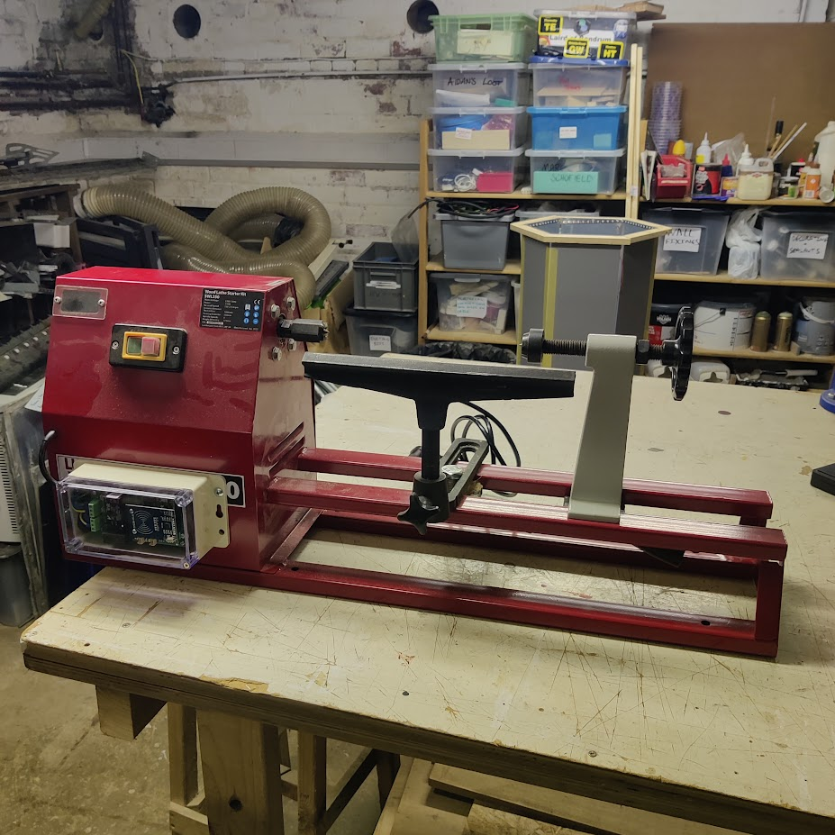

# Lumberjack Wood Lathe

This page is Work In Progress so should not be considered complete.

A Lumberjack SWL350 Wood Lathe

## Essential Information

- Location: North Basement Workshop
- Responsible Person(s): David Pye
- Induction Required: Yes

## Usage notes

The manual for this machine can be found [here](./SWL350.pdf).

You will be expected to demonstrate the following competencies before gaining RFID access to this machine:

- Use appropriate PPE while using this machine. (Wear a visor.  Consider hearing protection and dust mask.)
- Mount the machine to the workbench before use (TBC).
- Ensure the lathe is set to the correct speed, disconnecting the power supply before opening the pulley cover.
- Mark the centre of your work piece at either end by drawing two lines from corner to corner.
- Create a small hole at these centres with an Awl or a small drill bit.
- Unscrew the driving centre before driving it into the workpiece using a wooden mallet.
- Remove excess waste from the work piece with a plane or band saw creating an octagonal shape when looking at either end of the work piece.
- Screw the work piece and driving centre onto the headstock spindle, and then move the tailstock up to the rear end of the work piece and locate the centre to the tailstock spindle.
- Tighten the tailstock lock nut, and then turn the tailstock spindle wheel until the work is held firmly but still rotates freely. Tighten the spindle lock nut.
- Before turning on the machine, rotate the work piece one full turn by hand to make sure the work piece is freely rotating.