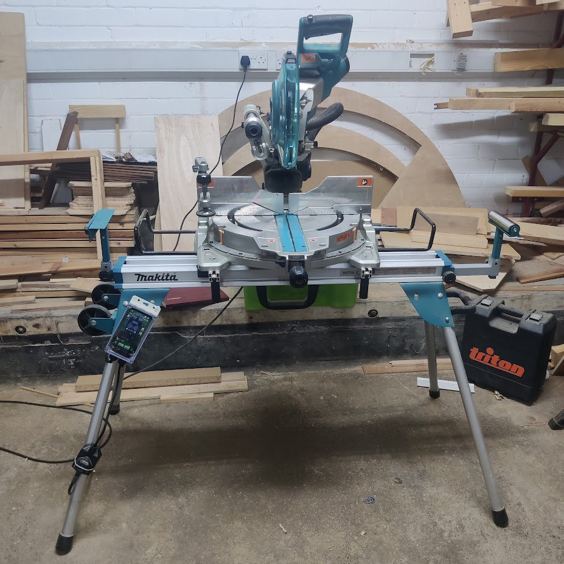

# Makita Chop Saw

Makita LS1019L Slide Compound Mitre Saw

## Essential Information

- Location: South Basement Workshop
- Responsible Person(s): Iain Yarnall
- Induction Required: No?

## Usage notes

The manual for this machine can be found [here](./LS1019L.pdf).

You will be expected to demonstrate the following competencies before gaining RFID access to this machine:

- Use appropriate PPE while using this machine. (Eye protection required.  Consider ear protection.)
- Use the Henry, connected to the dust port for dust extraction.
- Mitre saws are intended to cut wood or woodlike products, not metal.
- Use clamps to support the workpiece whenever possible. If supporting the workpiece by hand, you must always keep your hand at least 100 mm from either side of the saw blade.
- Do not use this saw to cut pieces that are too small to be securely clamped or held by hand.
- The workpiece must be stationary and clamped or held against both the fence and the table. Do not feed the workpiece into the blade or cut "freehand" in any way.
- Push the saw through the workpiece. Do not pull the saw through the workpiece.
- To make a cut, raise the saw head and pull it out over the workpiece without cutting, start the motor, press the saw head down and push the saw through the workpiece.
- Never cross your hand over the intended line of cutting either in front or behind the saw blade.
- Do not reach behind the fence while the blade is spinning.
- Always make certain that there is no gap between the workpiece, fence and table along the line of the cut.
- Do not use the saw until the table is clear of all tools, wood scraps, etc., except for the workpiece.
- Cut only one workpiece at a time.
- Plan your work. Every time you change the bevel or mitre angle setting, make sure the adjustable fence is set correctly to support the workpiece and will not interfere with the blade or the guarding system.
- Provide adequate support such as table extensions, saw horses, etc. for a workpiece that is wider or longer than the table top.
- Do not use another person as a substitute for a table extension or as additional support.
- The cut-off piece must not be jammed or pressed by any means against the spinning saw blade.
- Always use a clamp or a fixture designed to properly support round material such as rods or tubing.
- Let the blade reach full speed before contacting the workpiece.
- If the workpiece or blade becomes jammed, turn the mitre saw off. Wait for all moving parts to stop and disconnect from the power. Then work to free the jammed material.
- After finishing the cut, release the switch, hold the saw head down and wait for the blade to stop before removing the cut-off piece.
- The Stopper Pins for the Slide and Cutter Head should be engaged when you finish using the saw.
